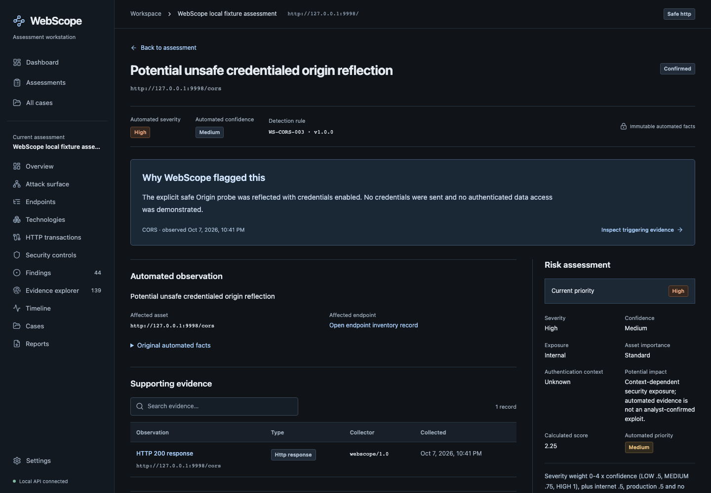
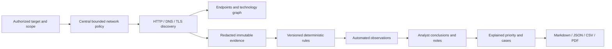
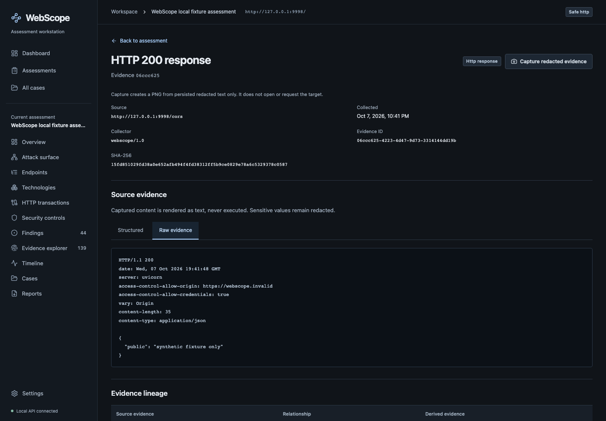
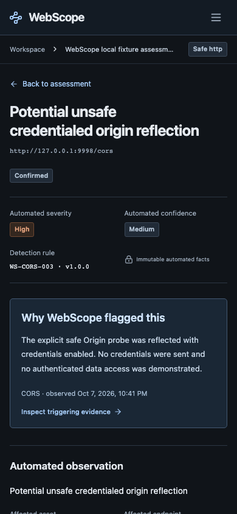

# WebScope

**Evidence-Driven Web Application Security Assessment Workstation**

**Deployment update:** WebScope now supports **Vercel + Render with no sign-in**.
Each browser session gets an isolated temporary workspace containing the complete
synthetic web investigation plus DNS/TLS examples. Users can upload **HAR,
WebScope assessment JSON and OpenAPI JSON**. Uploads and results expire after
24 hours, are deleted immediately by **End session**, and disappear earlier
on hosted restarts/redeploys. The UI prominently explains this before entry
and upload. [Deployment and retention guide](docs/deployment.md).

Hosted mode is deliberately **import-only**: it cannot scan targets. Authorized
network collection remains available in local mode. The Render blueprint uses
disposable storage, not a persistent disk; nothing has been deployed remotely
by preparing these files.

WebScope turns an explicitly authorized web target into an inspectable security
investigation: scoped discovery, application inventory, deterministic security
observations, preserved evidence, analyst conclusions, transparent priority,
cases, and technical reports. It runs locally without cloud infrastructure,
paid APIs, an LLM, or an external scanner.

It does not claim that a missing header, a banner, wildcard CORS, or an unusual
DNS record is automatically an exploitable vulnerability. Every finding shows
**Why WebScope flagged this**, its source evidence, rule/version, remediation,
and a separate analyst assessment.



## Installation

Requirements: Python **3.12+**, Node **20.19+** (or a compatible newer Node
release), npm, and a modern browser. Commands below run from the repository root.

```sh
python3.12 -m venv .venv
.venv/bin/python -m pip install -r backend/requirements.lock
.venv/bin/python -m pip install -e 'backend[test]'
cd frontend
npm ci
npm run build
cd ..
bash scripts/run-local.sh
```

Open **http://127.0.0.1:8765**. The script applies Alembic migrations before
starting the loopback-only API and serving the compiled frontend. Keep one
backend worker. The SQLite database defaults to `data/webscope.db`.
Choose **Start temporary workspace**; no account is required. Existing legacy
local assessments are not deleted by the migration, but browser sessions expose
only their own data. Sessionless local API access retains the legacy local
workspace; hosted APIs always require the anonymous session cookie.

For frontend development, keep the backend running and use another terminal:

```sh
cd frontend
npm run dev -- --host 127.0.0.1 --port 5173
```

Open **http://127.0.0.1:5173**. Vite proxies `/api` to the local backend.
`WEBSCOPE_DATA_DIR` can select another data directory; `WEBSCOPE_DATABASE_URL`
can select a SQLite URL. `WEBSCOPE_FRONTEND_DIR` selects the built asset folder.
Resolve custom paths deliberately; defaults assume the provided startup script.

## Core features

| Area | Working functionality |
|---|---|
| Assessment policy | Authorization statement, exact host allow/deny rules, excluded canonical paths, private-network opt-in, lifecycle and archive/delete controls |
| Controlled collection | DNS-pinned HTTP, explicit redirects, shared request/rate/duration limits, total timeouts, bounded gzip/deflate bodies, failures and coverage events |
| Discovery | HTML links/forms/resources, JavaScript text, robots/sitemap, manual inventory, local-ref OpenAPI imports, optional HEAD availability and OPTIONS observations |
| Infrastructure | A/AAAA/CNAME/MX/TXT/NS/SOA with TTL/resolver/time; certificate/SAN/validity/key/chain and negotiated TLS details |
| Analysis | Contextual headers, cookie attributes, CORS, explicit-path disclosure signatures, API response schema indicators, confidence-bearing fingerprints |
| Evidence | Redacted raw/structured explorer, request/response viewer, immutable provenance, same-assessment relationships, redacted evidence PNG captures |
| Analyst workflow | Status, written conclusions, notes, independent severity/confidence changes, explained risk overrides, linked cases and audit timeline |
| Visualization | Real interactive attack-surface graph, inventories, severity summary, technology relationships and responsive workstation pages |
| Reporting | Persisted Markdown, complete assessment JSON, native PDF, and CSV endpoints/findings/technologies/evidence index |
| Temporary uploads | Isolated no-sign-in workspaces, complete synthetic examples, validated HAR/WebScope/OpenAPI uploads, expiry and immediate deletion |

All required pages are implemented: Dashboard, Assessments, Create Assessment,
Overview, Attack Surface, Endpoints, Technologies, HTTP Transactions, Security
Controls, Findings/detail, Evidence Explorer/detail, Timeline, Cases/detail,
Reports, and Settings. Empty states are real empty inventories, not synthetic
dashboard data.

## Architecture



The backend is FastAPI/Pydantic v2/SQLAlchemy/SQLite with frozen Alembic
migrations, httpx, BeautifulSoup, dnspython, cryptography, ReportLab and Pillow.
The frontend is React/TypeScript/Vite/Tailwind/React Router/TanStack Query with
React Flow. See [architecture](docs/architecture.md).

## Assessment workflow and example

Start the intentionally weak **owned loopback fixture** in another terminal:

```sh
bash scripts/run-fixture.sh
```

The fixture is labeled **FOR LOCAL SECURITY TESTING ONLY** and binds only to
`127.0.0.1:9998`. Create an assessment for `http://127.0.0.1:9998`, allow only
`127.0.0.1`, exclude `/admin` and `/payments`, explicitly permit loopback,
record authorization, and choose SAFE_HTTP. Validate, then confirm discovery.
For explicit disclosure/CORS checks, configure `/.env`, `/.git/`, `/debug` and
`/cors`, then confirm Safe checks.

Inspect the graph and source evidence before reviewing a finding. Write a
conclusion, add notes, explain risk overrides, create a case, progress its
investigation/remediation/verification lifecycle, and generate reports.
`fixtures/api/openapi.json` adds synthetic API inventory without executing it.
The complete walkthrough is in [usage](docs/usage.md).

The committed example comes from an actual browser-driven local run:
**22 endpoints, 3 technology indicators, 12 HTTP transactions, 139 evidence
records, 44 automated observations and one closed investigation case**. These
are fixture results, not real-world security coverage claims.

| Example artifact | Contents |
|---|---|
| [Assessment JSON](docs/example/assessment.json) | Complete redacted snapshot, provenance, notes, cases, rules, risk, graph |
| [Technical Markdown](docs/example/assessment.md) | Scope, methodology, observations, evidence excerpts, conclusions, timeline |
| [PDF report](docs/example/assessment.pdf) | Native PDF with report sections, evidence references and page footers |
| [Endpoints CSV](docs/example/endpoints.csv) | 22 inventory rows |
| [Findings CSV](docs/example/findings.csv) | 44 observations with evidence/rule/analyst fields |
| [Technologies CSV](docs/example/technologies.csv) | 3 confidence-bearing indicators |
| [Evidence index CSV](docs/example/evidence.csv) | 139 source records and integrity hashes |
| [Workflow proof](docs/example/workflow-proof.json) | Actual IDs, collector request paths/timestamps, graph counts and report metadata |
| [Artifact verification](docs/example/artifact-verification.json) | Parsed PDF/CSV/JSON results, hashes, sizes and measured rate spacing |





## Security, evidence and rules

**Authorization is necessary but never bypasses scope.** Private/loopback
permission does not disable host/path/port restrictions. Redirects outside
scope are blocked before networking and recorded as evidence. Passive analysis
and OpenAPI imports issue no traffic. Every network attempt is audit logged.

Evidence is redacted before persistence and serialization. Supporting evidence
is mandatory for findings at the database level. Cross-assessment links,
orphaning evidence deletion, evidence edits and automated-fact rewrites are
rejected by relational constraints/triggers. Analyst decisions are separate.

Read the [security model](docs/security-model.md),
[evidence model](docs/evidence-model.md), and
[detection rules and risk formula](docs/detection-rules.md) before use.
The generated API schema is available at `/openapi.json`; API mutations require
JSON and `X-WebScope-Request: workstation`. CDN-backed Swagger/ReDoc pages are
disabled rather than creating an external dependency.

## Testing and proof

```sh
cd backend
../.venv/bin/pytest -q
../.venv/bin/ruff check app tests alembic
../.venv/bin/alembic check
cd ../frontend
npm test -- --reporter=dot
npm run build
```

For real browser E2E, start the API, Vite on 5173, and the fixture on 9998 in
separate terminals, then:

```sh
cd frontend
# If Chromium is not already installed:
npx playwright install chromium
npx playwright test --reporter=list
cd ..
.venv/bin/python scripts/verify-artifacts.py
```

Browser tests use real API writes and the owned fixture, save example reports
and desktop/mobile screenshots, and verify that excluded/imported/form
destinations were not requested. Unit/integration tests cover scope bypass
vectors, DNS pinning, redirects and shared budgets, measured spacing, timeouts,
compressed-body caps, redaction, malformed inputs, migrations, database
integrity, report contents, and a real loopback TLS handshake. DNS record tests
use deterministic fake resolvers, not public DNS.

The [45-section implementation matrix](docs/implementation-status.md) and
[verification record](docs/verification.md) distinguish executed proof from
limitations and optional/non-goal work. Test logs live in
`docs/verification-logs/`. No third-party target was scanned.

Current recorded result: **134 backend + 60 frontend + 3 browser tests passed**
(197 total, no failures or skips across the recorded suites). The browser suites separately cover the
local collection workflow and hosted temporary uploads. Production
build/typecheck, migration round-trip, deployment configuration validation and
compiled-app smoke checks also passed. The compiled-app check is reproducible with
`node scripts/verify-production.mjs` after starting only the compiled backend
and loads a fresh temporary synthetic workspace. See
[hosted verification](docs/hosted-verification.md) for exact current results;
the original seven example reports remain committed and independently parsed.

## Limitations and responsible use

- Local mode is not for public exposure. Hosted mode offers isolated anonymous
  temporary workspaces, not authenticated accounts or recovery. Do not run
  either mode with elevated privileges.
- HTTP collection does not execute target JavaScript or log into applications.
  Forms/imported mutation methods are inventory only. GET is not guaranteed
  side-effect-free in badly designed applications; exclude action URLs.
- TLS reports observed certificates and the negotiated protocol, not exhaustive
  cipher/protocol support. OS DNS packet retries are not independently counted;
  a lookup is one bounded operation.
- Redaction recognizes supported sensitive fields/patterns; it cannot reliably
  identify every opaque proprietary or unlabelled secret. Do not provide real
  credentials; review exports before sharing.
- Evidence captures are PNGs of redacted persisted text, **not** screenshots of
  rendered target pages. PDF/Markdown excerpts are bounded; complete redacted
  records are in JSON.
- OpenAPI 3.x JSON is supported, with local references, bounded expansion and
  server variables/defaults. Convert YAML locally. No remote/file refs are fetched.
- Fixture verification is not a claim of exhaustive Internet interoperability,
  authentication coverage, or exploit validation.

## Roadmap and non-goals

Optional external CVE/technology/DNS/certificate-transparency/threat-intelligence
adapters are intentionally **not installed or presented as functional**.
The local core remains independent of them. Future work can add broader
fingerprint fixtures, report theming, inventory pagination for very large
assessments, and additional explicit passive rules.

Credential brute force, destructive exploitation, authentication bypass,
malware, unrestricted crawling, port scanning, fake AI analysis and replacing
an interception proxy are non-goals. See [LICENSE](LICENSE).
