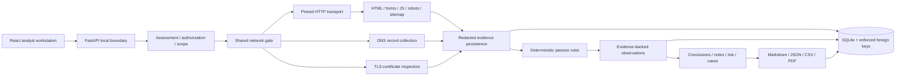

# Architecture

The hosted extension is described in [deployment.md](deployment.md):
Vercel's same-origin API rewrite fronts Render's import-only API; ephemeral
SQLite stores isolated anonymous workspaces. Migration `0004` adds workspace
expiry/hashed tokens and assessment ownership without exposing legacy local
records. A cleanup worker removes expired workspaces; hosted startup clears
previous sessions. All data-upload relationships are validated and re-keyed.

WebScope is a local-first investigation workstation. The backend
owns collection policy and evidence; the browser never contacts assessment
targets. There is no AI, scanner subprocess, remote intelligence dependency,
or target JavaScript execution.

## Code boundaries

| Module | Responsibility |
|---|---|
| `backend/app/main.py` | Pydantic API, local browser boundary, workflow transactions |
| `backend/app/models.py`, `db.py`, `alembic/` | Schema, constraints, migrations, immutable-fact triggers |
| `services/scope.py` | Exact hosts, ports, canonical paths, explicit authorization and network policy |
| `services/network.py` | One budget/rate/time gate; address validation and pinning; bounded HTTP transactions |
| `services/discovery.py` | Inventories derived from untrusted text and local OpenAPI refs; never executes imported operations |
| `services/infrastructure.py` | DNS record/TTL/resolver observations; certificate/chain/negotiated protocol |
| `services/technology.py` | Confidence-bearing, evidence-linked technology indicators |
| `services/analysis.py` | Versioned rules, contextual controls, findings, transparent risk |
| `services/store.py`, `redaction.py` | Persistence boundary, evidence hashes, timeline, analyst notes |
| `services/graph.py` | Actual persisted host/IP/endpoint/resource/technology/finding relationships |
| `services/reporting.py` | Frozen report snapshots and native PDF generation |
| `frontend/src/` | Task-focused pages, query invalidation, typed API, actual graph |
| `fixtures/`, `backend/tests/`, `frontend/tests/` | Deterministic fixtures and regression proof |

SQLAlchemy sessions are scoped to requests. Network runs persist RUNNING state
before collection and reject concurrent policy edits. Normal completion records
errors and coverage limits, not just counts. Startup changes interrupted RUNNING
assessments to FAILED with an audit event. Runs are not silently resumed.

## Persistence and lifecycle

Create DRAFT → explicitly authorize → validate READY → explicit collection
RUNNING → COMPLETED or FAILED. COMPLETED means the bounded execution finished,
not that the target is safe or fully covered. Excluded destinations, request
limits, TLS trust failures and parser errors remain visible in evidence/timeline.

An assessment must be ARCHIVED before permanent deletion. Archived assessments
remain inspectable/reportable but cannot collect, change findings, or add notes.
Restoring to DRAFT requires validation again. Deletion explicitly removes
restrictive relationships before cascading assessment-owned records.

The local SQLite directory is created with owner-only permissions. The default
database is `data/webscope.db` when started with the provided script. Generated
reports are database BLOBs with SHA-256 integrity hashes. Back up the data
directory only after stopping the backend or using SQLite's backup facilities.

## Deployment

Development uses Vite's same-origin `/api` proxy. A production frontend build
can be served by FastAPI on the same loopback origin. Use one backend worker:
in-process operations are deliberately local, not a distributed job queue.
Dependencies are separately declared and locked for backend and frontend.
